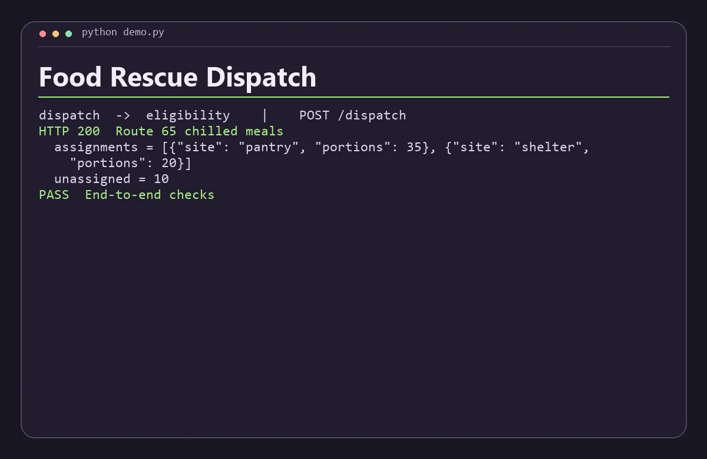

# Food Rescue Dispatch

Route surplus food batches to partner sites using separate eligibility and capacity-allocation services.



## Run the demo

Install Python 3.11+, Node.js 22+, then run this from the repository root.

```sh
python demo.py
```

The command starts both services on separate loopback ports, sends the requests in `examples.json`, checks the responses, and shuts down the processes. Use `python3` if that is how your system exposes Python.

## Run the services with Docker Compose

```sh
docker compose up -d --build
python demo.py --base-url http://127.0.0.1:8080
docker compose down
```

The API binds to loopback on port 8080 by default. Set `DEMO_PORT` and use the matching base URL to run another project alongside it. Set-up and service discovery follow the [Docker Compose networking documentation](https://docs.docker.com/compose/how-tos/networking/).

Both services are stateless and work with the data in each request. Start from fresh demo state before rerunning the scripted Compose checks.

## Architecture

Eligibility applies cold-storage and pickup-radius constraints. Dispatch assigns whole portions to eligible sites in distance order, with site ID breaking ties.

| Service | Runtime | Operation |
| --- | --- | --- |
| `dispatch` | JavaScript | Public demo API, `POST /dispatch` |
| `eligibility` | Python | Internal service, `POST /eligible` |

The two services exchange JSON over HTTP. Each has a `GET /health` endpoint for process readiness. A gateway request returns HTTP 502 when its dependency is unavailable or fails unexpectedly. Invalid input returns HTTP 400. Domain conflicts return HTTP 409 where supported.

## API example

Send portions, cold (boolean), radiusKm, and partners with id, distanceKm, capacity and refrigeration. The allocator handles a single request using straight-line distances supplied by the caller. It does not reserve real capacity.

From a running Compose stack, save this JSON as `input.json` and run the command below. On Windows use `curl.exe` if your shell aliases `curl`.

```json
{
  "portions": 65,
  "cold": true,
  "radiusKm": 8,
  "partners": [
    {
      "id": "pantry",
      "distanceKm": 2,
      "capacity": 35,
      "refrigeration": true
    },
    {
      "id": "school",
      "distanceKm": 1,
      "capacity": 100,
      "refrigeration": false
    },
    {
      "id": "shelter",
      "distanceKm": 4,
      "capacity": 20,
      "refrigeration": true
    },
    {
      "id": "county",
      "distanceKm": 12,
      "capacity": 90,
      "refrigeration": true
    }
  ]
}
```

```sh
curl -s -H "Content-Type: application/json" --data-binary @input.json http://127.0.0.1:8080/dispatch
```

The response includes these fields.

```json
{
  "assignments": [
    {
      "site": "pantry",
      "portions": 35
    },
    {
      "site": "shelter",
      "portions": 20
    }
  ],
  "unassigned": 10
}
```

## Scope

This is a local portfolio project using synthetic data. The APIs are intended for loopback and the private Compose network. A public deployment would need authentication, rate limits, and production observability.
